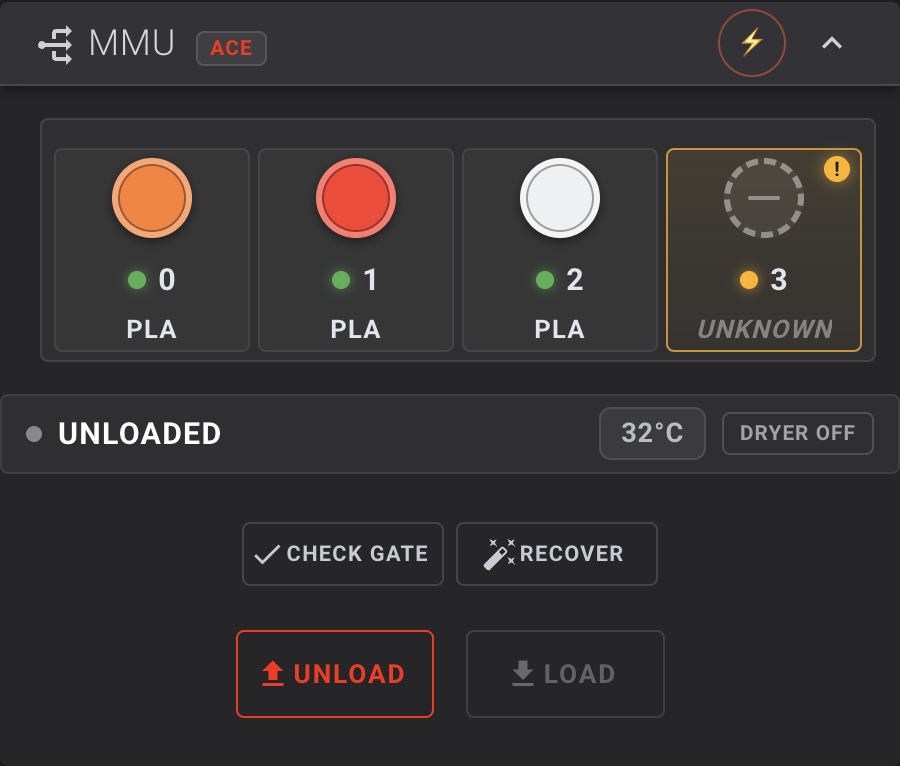
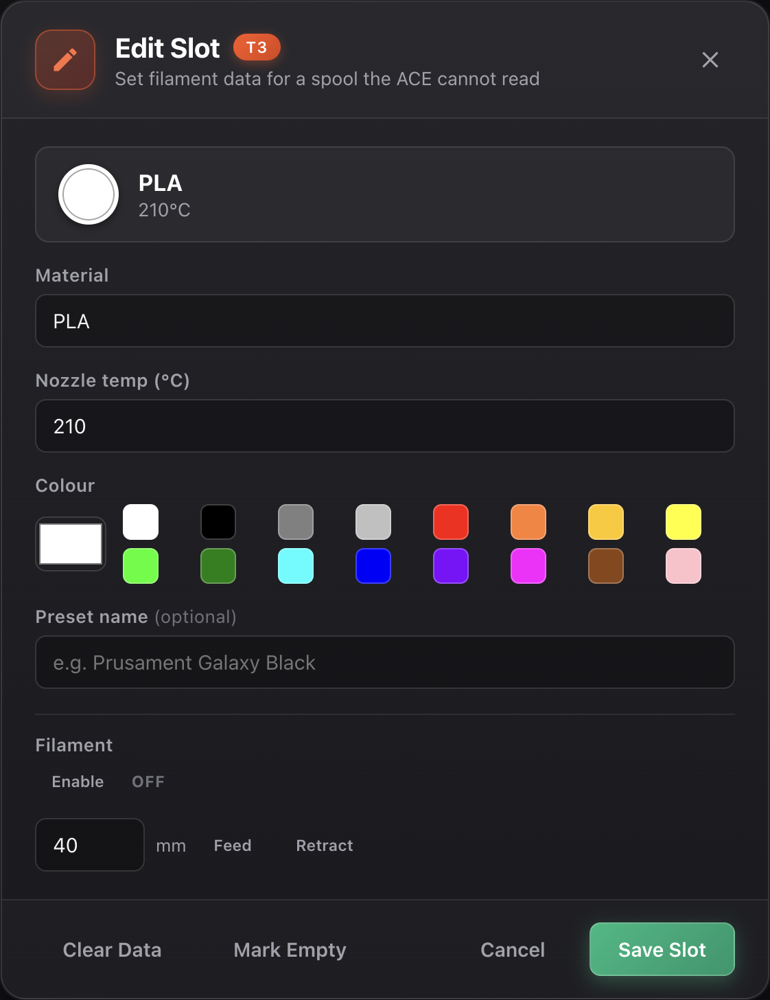
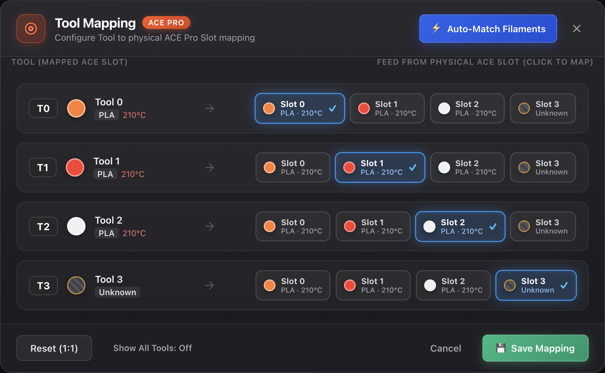

# KLIPPACE – Universal Klipper Extension for Anycubic ACE Pro

[](https://www.gnu.org/licenses/gpl-3.0)
[](https://www.python.org/)
[](https://www.klipper3d.org/)
[](#)
[](#)

> [!WARNING]
> ### ⚠️ Work in Progress
> **KLIPPACE is very much an active work in progress!** Features, configuration schemas, and macros are subject to active development and frequent updates. Please test all hardware motions, cutter strokes, and feed distances carefully before running production prints. Feedback, bug reports, and contributions are welcome!

> [!NOTE]
> ### 🤖 AI Notice
> This project utilizes Artificial Intelligence (AI) tools to assist with development, code refactoring, and documentation. While configurations are tested and verified on physical hardware, always inspect macros, verify pin assignments, and test mechanical clearances before operating your printer unattended.

A powerful, universal Klipper extension that brings the **Anycubic ACE Pro** multi-material unit to **any** Klipper-based 3D printer — Voron 2.4, RatRig, Anycubic Kobra, Sovol, Ender, and custom CoreXY or bed-slinger machines.

KLIPPACE manages high-speed Bowden feeding, dual-sensor toolhead coordination, differential pressure feeding, filament tip cutting, Blobifier tray nozzle parking, purge management, nozzle scrubbing, endless spool failover, and Moonraker lane synchronization.

Supports **multiple ACE Pro units** via `ace_count` (one `AceInstance` per unit, tool numbers assigned in unit order). **Only single-unit configurations have been tested on hardware so far** — multi-unit support is implemented but unverified.

---

## 📋 Table of Contents

- [✨ Features](#-features)
- [📦 Installation](#-installation)
- [⚙️ Printer Profiles & Configuration](#️-printer-profiles--configuration)
  - [Voron 2.4 (CoreXY) Profile](#voron-24-corexy-profile)
  - [Anycubic / Generic Profile](#anycubic--generic-profile)
- [🔌 Slicer Setup & OrcaSlicer Integration](#-slicer-setup--orcaslicer-integration)
  - [Native Filament Sync](#native-filament-sync)
  - [Machine G-Code Setup](#machine-g-code-setup)
  - [Optimized Flush Volume Post-Processing Script](#optimized-flush-volume-post-processing-script)
- [🧪 Usage & Commands](#-usage--commands)
- [♻️ Endless Spool & Contextual Start Purge](#️-endless-spool--contextual-start-purge)
- [🔌 Connection Supervision](#-connection-supervision)
- [🖥️ Web Dashboard & KlipperScreen](#️-web-dashboard--klipperscreen)
- [🛠️ Development & Testing](#️-development--testing)
- [� Security Notes](#-security-notes)
- [�🔧 Troubleshooting](#-troubleshooting)
- [🙏 Credits & License](#-credits--license)

---

## ✨ Features

### Core Multi-Material Engine
- **Universal Kinematics** – Seamlessly operates on CoreXY flying gantries (Voron 2.4), fixed gantry / bed-slingers (Kobra, Ender, Sovol), and dual-gantry setups.
- **Multi-ACE Chaining** – Drives multiple ACE Pro units from a single manager, one `AceInstance` per unit, with tool numbers and gate indices assigned in unit order. Set the count with `ace_count` in `[ace]`; the code enforces no upper bound, though the shipped profiles configure 1–2 units. **Only one connected unit has been tested on hardware** — treat multi-unit setups as unverified and check gate ordering before relying on them.
- **Dual-Sensor Toolhead Coordination** – Coordinated entry and seating using both an upper entry sensor (`EBB:PD0`) and lower nozzle sensor (`EBB:PA15`).
- **Sensor-Terminated Feeding** – The ACE feed is stopped the moment the toolhead entry sensor trips, instead of running a fixed commanded length and only then checking the switch. Filament therefore ends up at a *known* point on both success and failure, the stated length no longer has to be exact, and a failed load no longer leaves the filament at an unknown place in a metre of Bowden tube.
- **Differential Forward Pressure Feeding** – Pushes from the ACE at differential speeds (`ace_entry_feeding_speed: 16` vs `extruder_feeding_speed: 8`) to overcome mechanical switch friction and seat firmly into extruder drive gears (e.g. WW BMG).
- **Splitter Auto-Park (Path A)** – Automatically rewinds 400mm on spool insertion (`spool_load_park_retract_length: 400`), safely parking the filament tip ~50mm before a passive 4-in-1 splitter so other slots can feed without collisions.
- **Coordinated Dual-Blob Toolchanging (Voron 2.4 Profile)**:
  - **Blob 1 (Load Feed Blob)** – As new filament enters the extruder, KLIPPACE coordinates an exponential Z-lift (`Z2.6 → Z12.6`) via `_ACE_LOAD_PURGE` with 100% part cooling during the ACE push to create a solid, clean vertical load blob instead of buckling.
  - **Blob 2 (Purge Blob)** – Pulsating extrusion via Blobifier v1.5 (`BLOBIFIER`) flushes the transition color cleanly into the purge bucket.
  - **High-Velocity Cooling Freeze** – Blasts dual 24V part cooling fans at 100% power during a 5-second dwell (`pressure_release_time: 5000`), freezing the blob rock-solid so the servo tray retracts without squishing or stringing.
- **Continuous Zigzag Scrubbing with Y-Axis Jitter** – Advanced 40mm nozzle wipe across the Decontaminator brush (`X96–X136 Y360 Z3.0`) with sinusoidal Y-axis jitter ($\pm 4.0\text{mm}$, alternating between Y358.0 and Y360.0) every 5mm along X for complete, non-linear nozzle tip and flank cleaning.
- **Dual 24V Part Cooling Architecture** – Fully harnesses upgraded 24V blower fans via `[multi_pin dual_fan]` on `EBB:PD3` and `EBB:PA5` driven at 100% full power (`max_power: 1.0`).
- **Mechanical Gantry Cutting** – Integrated support for A4T Crossbow / gantry cutter pins (`CUT_TIP` at `X2 Y357`) with obstacle avoidance and post-cut retraction.
- **Blobifier Purge Bucket Detection** – Real-time switch/optical monitoring (`blobifier_bucket` on `PF4`) preventing print failure from purge waste overflow.
- **Smart Contextual Start Purge** – Remembers the residual filament in the hotend (`ace_last_loaded_tool`). Automatically calculates differential purge volumes at `PRINT_START` (standard 35mm when loading the same tool, heavy 85mm when purging out a different color/material).
- **Automatic 1:1 Tool-to-Gate Reset** – Automatically resets temporary tool-to-gate remappings back to 1:1 when a print ends or is cancelled (`MMU_TTG_MAP RESET=1` restores it manually).
- **Endless Spool Failover** – Automatically rolls over to a spool with the **same material and the same colour** upon runout. Anything less is left to you: the print stays paused rather than continuing in a different colour.
- **Manual Slot Data Editor** – Non-RFID spools cannot be identified by the ACE, so any gate on the web card can be clicked to record its material, colour and nozzle temperature. Slots holding filament but no data are flagged with an amber marker. **Clear Data** wipes the metadata while keeping the spool marked as loaded; *Mark Empty* tells Klipper the slot holds nothing. Values persist to disk immediately, so they survive a restart.
- **Happy Hare Compatibility Shim** – Exposes the standard `mmu` and `mmu_machine` printer objects (`gate_status`, `gate_color`, `gate_material`, `gate_spool_id`, `filament_pos`, `action`, `ttg_map`, …) plus the `MMU_*` command set, so Fluidd and Mainsail render their native multi-material card without knowing ACE Pro exists. Fields are published under every spelling clients actually read — `gate_temp` (Fluidd) alongside `gate_temperature` (Mainsail), and `espooler`/`espooler_active` for the rewind-assist indicator.
- **Moonraker & OrcaSlicer Lane Sync** – Publishes your ACE Pro inventory to Moonraker in both shapes OrcaSlicer understands: the Happy Hare `[mmu]` object (`gate_status`, `gate_color`, `gate_material`, `gate_temperature`) and the `lane_data` database namespace (colour, material, nozzle/bed temperature, vendor, SKU).
- **Native OrcaSlicer Filament Sync** – OrcaSlicer's built-in Klipper/Moonraker printer agent pulls your spool colours and materials straight from the printer — no plugin to install, no restart, and no preset files written. See [Slicer Setup](#-slicer-setup--orcaslicer-integration).
- **Fluidd / Mainsail Auto-Match Tool Mapper** – Streamlined 1-click slot selector and automated toolhead-to-gate assignment directly in the Web UI.
- **Integrated ACE Dryer Control** – Regulates and monitors heating in the **ACE Pro's own drying chamber** (`[temperature_ace]` / `[temperature_sensor ace_dryer]`), which holds the spools. This is a separate probe from `[temperature_sensor chamber]`, the printer enclosure that `PRINT_START` soaks to `TARGET_CHAMBER`; `DRYER_STATUS` reports both, labelled. A cycle started by `PRINT_START` is stopped automatically at print end.

---

## 📦 Installation

### Prerequisites
- Klipper installed and running on Python 3.9+.
- One or more Anycubic ACE Pro units connected via USB.
- Moonraker and Mainsail or Fluidd installed.

> [!IMPORTANT]
> Development and testing have been done against a **single ACE Pro unit (4 slots)**.
> Configuring `ace_count` above 1 is implemented but has not been verified on
> hardware — check gate ordering before relying on a multi-unit setup.

### Interactive Setup & Installer

Clone the repository and run the setup script:

```bash
cd ~
git clone -b dev https://github.com/Yheffe/KLIPPACE.git
cd KLIPPACE
chmod +x installer.sh uninstaller.sh
./installer.sh
```

**Non-Interactive / Scripted Usage:**
```bash
# Voron 2.4 Profile
./installer.sh --profile voron -y

# Generic / Bed-Slinger Profile
./installer.sh --profile generic -y

# Pick the web interface explicitly (otherwise the installer prompts for one)
./installer.sh --profile voron --web-ui fluidd -y
./installer.sh --profile voron --web-ui mainsail -y
./installer.sh --profile voron --web-ui none -y     # Moonraker API only, no web UI
```

The installer will:
1. Detect your Klipper directory and symlink the core Python modules into `klippy/extras/`.
2. Symlink `virtual_pins.py` and the `temperature_ace.py` sensor.
3. Prompt you to select your printer profile:
   - **`1) Voron 2.4`**: Copies the modular `config/voron24/` suite (including Blobifier v1.5) into `~/printer_data/config/` and adds `[include ace_voron24.cfg]` and `[include blobifier.cfg]` to `printer.cfg`.
   - **`2) Anycubic Kobra`** or **`3) Generic`**: Copies `acepro.cfg`, `acepro_setting.cfg`, `acepro_macros.cfg`, and optional `spoolman_logic.cfg`.
4. Configure the **Moonraker Update Manager** (`[update_manager KLIPPACE]`) in `moonraker.conf` for one-click Web UI updates.
5. Optionally install the **ACE Status Moonraker Component** and Web Dashboard. You are asked to pick **one** web interface (Fluidd or Mainsail) — almost everyone runs one, and linking the card into both is a common source of confusion (see [Web Dashboard](#️-web-dashboard--klipperscreen)).
6. Optionally link the **KlipperScreen** panel and menu entries.

Restart Klipper when the installer completes:

```bash
sudo service klipper restart
```

> [!NOTE]
> After updating or installing the web dashboard, perform a hard refresh in your browser (`Ctrl + F5` on Windows/Linux, `Cmd + Shift + R` on macOS).

### Clean Uninstallation

If you ever wish to remove KLIPPACE:

```bash
./uninstaller.sh
```

The uninstaller creates timestamped backups of all modified files, cleanly strips include lines and Moonraker sections, removes web dashboard assets, and prompts before deleting configuration files.

---

## ⚙️ Printer Profiles & Configuration

### Voron 2.4 (CoreXY) Profile

Calibrated for a Voron 2.4 (350mm) running an A4T toolhead with multi-material Bowden feeding:
- **Toolhead Board**: BTT EBB36 GEN2 (STM32G0B1, CAN/USB)
- **Part Cooling**: Dual 24V blower fans via `[multi_pin dual_fan]` (`EBB:PD3` and `EBB:PA5`) at `max_power: 1.0`
- **Extruder**: WW BMG (WristWatch BMG, 50:10 gear ratio)
- **Sensors**: Dual-sensor toolhead entry switch (`^EBB:PD0`) and nozzle seated switch (`^EBB:PA15`)
- **Filament Cutter**: Crossbow Cutter (gantry pin at `X2 Y357`, approach `X2 Y340`)
- **Blobifier Purge & Park**: Servo tray at `X5 Y360` (Tray top: `Z2.4`, Purge height: `Z2.6`)
- **Nozzle Scrubbing**: Decontaminator brush (`X96–X136 Y360 Z3.0`) with $\pm 4.0\text{mm}$ Y-axis zigzag jitter

The Voron profile is fully modular and lives in `config/voron24/`:

| File | Purpose |
| :--- | :--- |
| [`ace_voron24.cfg`](config/voron24/ace_voron24.cfg) | Master include file. Place `[include ace_voron24.cfg]` at the top of your `printer.cfg`. |
| [`ace_voron24_vars.cfg`](config/voron24/ace_voron24_vars.cfg) | Physical coordinates for Crossbow Cutter (`X2 Y357`), Blobifier Tray (`X5 Y360 Z2.6`), and Brush (`X96-136 Y360 Z3.0`). |
| [`ace_voron24_hardware.cfg`](config/voron24/ace_voron24_hardware.cfg) | Pin definitions for Entry Sensor (`^EBB:PD0`) and Nozzle Sensor (`^EBB:PA15`). |
| [`ace_voron24_setting.cfg`](config/voron24/ace_voron24_setting.cfg) | Calibrated feed lengths (1050mm total, 400mm auto-park, 16/8 mm/s differential entry). |
| [`ace_voron24_macros.cfg`](config/voron24/ace_voron24_macros.cfg) | Voron-safe macros: `CUT_TIP`, `_ACE_LOAD_PURGE`, `BLOBIFIER_PARK`, `CLEAN_NOZZLE`, `RESUME_NOZZLE_WIPE_SEQUENCE`. |
| [`blobifier.cfg`](config/voron24/blobifier.cfg) | Official Blobifier v1.5 pulsating purge routine, bucket ejection, and shake-off sequence. |
| [`blobifier_hw.cfg`](config/voron24/blobifier_hw.cfg) | Hardware pin definitions for Blobifier servo (`PE9` on Octopus Max EZ). |

> [!TIP]
> **Complete Voron Setup Guide**: Read [VORON24_SETUP.md](VORON24_SETUP.md) for full physical tube routing diagrams, step-by-step sensor calibration, and wiring details.

### Anycubic / Generic Profile

For standard bed-slingers and custom printers with servo-actuated purge baskets:

| File | Purpose |
| :--- | :--- |
| `acepro.cfg` | Master configuration include. |
| `acepro_setting.cfg` | Driver parameters, tube lengths, feed speeds, and sensor assignments. |
| `acepro_macros.cfg` | Purge, wipe, servo poop basket angles, and pause/resume logic. |
| `acepro_printer_macros.cfg` | Generic `MY_START_PRINT` and printer helper hooks. |
| `spoolman_logic.cfg` | (Optional) Spoolman RFID tag mapping and slot tracking integration. |

---

## 🔌 Slicer Setup & OrcaSlicer Integration

KLIPPACE integrates with **OrcaSlicer** using OrcaSlicer's own built-in **Klipper/Moonraker
printer agent** — there is no plugin to install — plus optimised print macros and a
post-processing flush conversion script.

### Native Filament Sync

KLIPPACE publishes your ACE Pro inventory to the printer, and OrcaSlicer pulls it in
itself:

| Data | Where KLIPPACE publishes it |
| :--- | :--- |
| Happy Hare MMU shape | `[mmu]` printer object — `num_gates`, `gate_status`, `gate_color`, `gate_material`, `gate_temperature` |
| Moonraker DB lanes | `lane_data` namespace — `lane1`…`laneN` with colour, material, nozzle/bed temperature, vendor and SKU |

OrcaSlicer's `MoonrakerPrinterAgent` reads both, so there is nothing to install and
nothing to keep in sync.

#### One-time setup

1. **Preferences → Experimental Features → enable "Use printer agents instead of print hosts"**
2. In your printer's settings, set **Printer Agent → `Moonraker`** (and **Host Type →
   `Moonraker (Klipper)`** if you use the classic host flow). Both live in the
   printer-connection section.
3. **Preferences → Developer → enable "Show unsupported presets".**

   OrcaSlicer ships every manufacturer's filament presets, but hides those that are
   bound to a different printer — so with a Voron selected, the entire Anycubic (or
   Prusa, or Elegoo) vendor disappears from the filament list. This option reveals
   them and makes them selectable.
4. **Restart OrcaSlicer.**

Then use OrcaSlicer's native **Synchronize Filament Information** action in the
Print / Device flow. It updates the active project's filament list in place — **no
restart, and no preset files are written.**

#### What native sync carries

Native sync carries **filament type and colour** for every slot, plus a matching
flush-volume matrix. That is the whole of it.

Each slot is matched to a preset **by material type**, so a PLA spool arrives as
`Generic PLA @System` carrying the ACE's exact colour. The per-slot spool name,
vendor and temperature are read from the printer but are *not* applied to the
resulting preset.

> Only synchronize filament type and color, not including slot information.
> — OrcaSlicer's own description of the feature

If you would rather slice with the manufacturer's own profile, pick it per slot
after syncing: click the filament in OrcaSlicer's filament list and choose
`Anycubic PLA`, `Anycubic PETG`, and so on. Step 3 above is what makes those
selectable. OrcaSlicer's copy of the profile brings its own temperatures, flow and
volumetric limits, which is more accurate than anything a sync could inject.

#### Troubleshooting

| Symptom | Cause |
| :--- | :--- |
| The sync action does nothing | `use_printer_agents` is off, or the printer's agent is still `orca` rather than `moonraker`. |
| `NetworkAgent::set_user_selected_machine: no printer agent` in `log/debug_*.log` | Same as above — the generic agent is selected, so nothing probes the printer. |
| `Detected Happy Hare MMU with N gates` never appears | OrcaSlicer could not reach Moonraker. Check the printer's address in the printer settings. |
| `command_handle_response, error reponse.` repeating about once a second | **Expected, harmless.** Enabling printer agents routes the printer through Bambu's `MachineObject` control path, which emits Bambu fan/air-duct commands a Klipper printer cannot answer. It is log noise only (~14 MB/day at default log level). Turn agents back off if you would rather not have it. |
| `Unsupported printer type: Voron2_350` once at startup | The same path rewrites the local machine's `printer_type`. Cosmetic; the machine still connects. |

> [!NOTE]
> With printer agents enabled, OrcaSlicer takes over the printer connection for
> *uploads* as well as filament sync. Verify a real upload works before relying on
> it, and re-check the printer's access code if uploads fail — the agent path has
> been observed clearing it.

---

### Machine G-Code Setup

> [!IMPORTANT]
> **The Machine Start G-code below is specific to this project's Voron 2.4 build** and
> will not work unchanged on another printer. `PRINT_START` is defined only in
> [`VORON/printer.cfg`](VORON/printer.cfg) — the Voron profile's own printer config — and
> it calls a chain of macros that assume Voron hardware. The **Filament Change** and
> **Layer Change** snippets that follow are generic; the **Machine Start** block is not.
> See [Running a different printer](#running-a-different-printer) for what to do instead.

#### 1. Machine Start G-Code (Voron 2.4)

In your OrcaSlicer **Printer Settings -> Custom G-code -> Machine start G-code**:

```gcode
PRINT_START BED=[bed_temperature_initial_layer_single] EXTRUDER=[nozzle_temperature_initial_layer] INITIAL_TOOL=[initial_tool] DRYER_MATERIAL=[filament_type]
```

`PRINT_START` will home, heat the bed, execute Quad Gantry Leveling (QGL), calibrate bed mesh, park the nozzle over the Blobifier tray (`X5 Y360 Z2.6`), check the last loaded tool against the initial tool to determine whether standard (35mm) or heavy transition (85mm) purge is required, heat the hotend to initial extrusion temperature, load the designated initial tool (`ACE_ON_PRINT_START`) while forming the initial load feed blob, scrub the nozzle across the Decontaminator brush, optionally start the ACE Pro dryer (`DRYER_START`), and execute an adaptive first-layer line purge (`LINE_PURGE`) next to the sliced object before beginning the first layer.

Every step of that chain assumes hardware from this Voron build:

| Step in `PRINT_START` | Requires |
| :--- | :--- |
| `WAKE_LIGHTS`, `UPDATE_SPOOL_LEDS` | `config/voron24/led_control.cfg` |
| `G28`, `QUAD_GANTRY_LEVEL`, `G28 Z` | A Voron-style quad gantry |
| `CLEAN_NOZZLE` | Decontaminator brush at `X96–X136 Y360` |
| `TEMPERATURE_WAIT SENSOR="temperature_sensor chamber"` | `[temperature_sensor chamber]` in `printer.cfg` |
| `ACE_ON_PRINT_START` | `config/voron24/ace_voron24_macros.cfg`, plus the Blobifier tray at `X5 Y360` |
| `LINE_PURGE` | `VORON/printer.cfg`; purges adjacent to the sliced object |
| `DRYER_START` | ACE Pro only — the one step that is *not* Voron-specific |

#### Machine End G-Code

`PRINT_END` is the counterpart, and OrcaSlicer calls it from **Machine end G-code**. It
retracts to break the string, cuts the tip and rewinds the active spool into the ACE box,
stows the Blobifier tray, shuts the heaters off, **stops the ACE dryer if a cycle is
running**, parks the toolhead at rear centre (`X175 Y354`), clears any pause state and
resets tool-to-gate mapping to 1:1. Steppers are then released and the Nevermore continues
scrubbing the chamber for ten minutes.

The dryer stop is placed after `TURN_OFF_HEATERS` so a dryer fault cannot delay the
essential shutdown. It only fires when a cycle is actually running, so an idle dryer is
not sent a redundant stop command and the console stays quiet. Note that this means a
cycle you started by hand *is* stopped at print end — restart it with `DRYER_START` if you
want it to continue.

#### Running a different printer

**The generic / Anycubic profile does not define `PRINT_START` at all.** It ships
`MY_START_PRINT` in [`acepro_printer_macros.cfg`](config/acepro_printer_macros.cfg), which
handles the ACE initial-tool load and then passes straight through to your printer's own
`START_PRINT` (and passes through untouched when the ACE is disabled):

```gcode
MY_START_PRINT TOOL=[initial_tool] BED_TEMP=[bed_temperature_initial_layer_single] EXTRUDER_TEMP=[nozzle_temperature_initial_layer]
```

If you are adapting KLIPPACE to your own machine, the portable parts are the ACE hooks —
`ACE_ON_PRINT_START`, `DRYER_START`, `LINE_PURGE` and the tool-change macros. Home, QGL,
bed mesh and nozzle scrubbing belong to your printer's own start sequence, not to this
file. Replace those steps with the equivalent from your printer's configuration, or call
your existing `START_PRINT` and invoke the ACE hooks around it.

#### 2. Filament Change G-Code
In OrcaSlicer **Printer Settings -> Multimaterial -> Change filament G-code**:

```gcode
T[next_extruder]
```

#### 3. Layer Change G-Code
In OrcaSlicer **Printer Settings -> Custom G-code -> Layer change G-code**:

```gcode
;AFTER_LAYER_CHANGE
SET_PRINT_STATS_INFO CURRENT_LAYER={layer_num + 1}
M117 Layer {layer_num + 1}/[total_layer_count] : {filament_settings_id[0]}
```

---

### Optimized Flush Volume Post-Processing Script
Under OrcaSlicer **Print Settings -> Others -> Post-processing scripts**:

```
/usr/bin/python3 /home/pi/KLIPPACE/slicer/orca_flush_to_purgelength.py
```

This script translates OrcaSlicer's flush matrix directly into optimal `PURGELENGTH` values for each tool change.

> [!NOTE]
> The paths above are for a Raspberry Pi running Klipper from `/home/pi/KLIPPACE`, using
> the system Python. Adjust the interpreter and the repository path to match your host —
> for example `/usr/bin/python3 ~/KLIPPACE/slicer/orca_flush_to_purgelength.py` — and make
> sure the script stays executable. The script itself is printer-agnostic.

---

## 🧪 Usage & Commands

Standard Klipper tool change commands (`T0`, `T1`, `T2`, `T3`, ...) are fully supported. Additional commands provide manual diagnostic and maintenance control:

| Command | Description |
| :--- | :--- |
| `T<tool>` | Initiate a complete tool change to tool number `<tool>` (0–11). |
| `ACE_GET_STATUS` | Display comprehensive ACE hardware state, temperatures, and slot status. `INSTANCE=` or `TOOL=` to narrow, `VERBOSE=1` for detail. |
| `ACE_CHANGE_TOOL TOOL=<n>` | Change to tool `<n>`. Set `TOOL=-1` to perform a complete unload back to the ACE. |
| `ACE_SET_SLOT T=<n> ...` | Record filament data for a slot: `COLOR="R,G,B"` or a named colour, `MATERIAL=`, `TEMP=`, and optional `FILAMENT_SETTINGS_ID="name"`. Add `CLEAR=1` to wipe the data while keeping the spool marked loaded, or `EMPTY=1` to mark the slot empty. |
| `ACE_SAVE_INVENTORY` | Persist the current slot inventory to disk. Slot writes flush automatically; this forces it explicitly. |
| `ACE_PARK_SLOT SLOT=<n>` | Manually rewind slot `<n>` by 400mm back before the 4-in-1 splitter (`PARK_SLOT` is a macro alias). |
| `ACE_PARK_ALL_SLOTS` | Rewind all loaded slots by 400mm back before the splitter (`PARK_ALL_SLOTS` is a macro alias). |
| `MMU_TTG_MAP TOOL=<t> GATE=<g>` | Remap logical slicer tool `<t>` to physical gate `<g>`. `MMU_TTG_MAP RESET=1` restores the default 1:1 mapping and is called automatically on print end. |
| `MMU_LOAD` / `MMU_UNLOAD` | Standard Happy Hare load/unload. Add `EXTRUDER_ONLY=1` to move just the entry-sensor-to-nozzle segment without a full toolchange. |
| `MMU_CHECK_GATE` | Refresh ACE slot RFID and presence telemetry (alias of `ACE_QUERY_SLOTS`). |
| `MMU_RECOVER` | Reset the active toolhead / spool state (`ACE_RESET_ACTIVE_TOOLHEAD`). |
| `BLOBIFIER_PARK` / `PARK` | Park nozzle over the extended Blobifier tray (`X5 Y360 Z2.6`). |
| `_ACE_LOAD_PURGE` | Coordinated exponential Z-lift (`Z2.6 → Z12.6`) and 100% fan during initial load feed to form load blob. |
| `BLOBIFIER` | Primary Blobifier v1.5 purge: builds a compact blob, ejects it via the servo tray, and scrubs the nozzle. |
| `BLOBIFIER_EJECT_BLOB` | Eject the formed blob without running the full purge sequence. |
| `BLOBIFIER_SERVO POS=out\|in` | Manually command the Blobifier servo tray extended (`out`) or retracted (`in`). |
| `BLOBIFIER_STATUS` | Report blob count, bucket state and servo position. |
| `RESUME_NOZZLE_WIPE_SEQUENCE` | Execute continuous 40mm X-axis scrub across brush with alternating $\pm 4.0\text{mm}$ Y-axis jitter. |
| `LINE_PURGE` / `ADAPTIVE_PURGE` | Adaptive first-layer bed line purge adjacent to object perimeter (used in `PRINT_START`). |
| `LIFT_FROM_STOPPER` | Lift nozzle off the Blobifier tray to safe clearance height (`Z15`). |
| `CUT_TIP` | Execute filament cut stroke against gantry cutter pin (`X2 Y357`). |
| `CLEAN_NOZZLE` | Perform multi-pass nozzle scrub across the brass/silicone brush. |
| `DRYER_START` | Start ACE Pro dryer with temp and duration (e.g. `TEMP=50 DURATION=240` or `MATERIAL=PLA`). Clamped to `max_dryer_temperature`. |
| `DRYER_STOP` | Stop the ACE Pro dryer. Called automatically by `PRINT_END` if a cycle is running. |
| `DRYER_STATUS` | Print ACE dryer temperature, target, status and remaining time, plus the printer chamber temperature. |
| `ACE_FEED T=<tool> LENGTH=<mm>` | Manually feed filament forward from a specific slot. |
| `ACE_RETRACT T=<tool> LENGTH=<mm>` | Manually retract filament from a specific slot. |
| `ACE_FULL_UNLOAD` | Unload until the slot reports empty. `TOOL=<index>`, `TOOL=ALL`, or omit for the current tool. |
| `ACE_DEBUG_SENSORS` | Query current real-time state of all configured filament switches. |
| `ACE_QUERY_SLOTS` | Scan and refresh RFID and manual filament inventory across all ACE slots. |
| `ACE_FLUSH` | Persist any pending deferred variable changes to disk immediately. |
| `UPDATE_ALL_MCUS` | Compile and flash firmware to all MCUs (Octopus Max EZ & EBB36) with safety checks. |

---

## ♻️ Endless Spool & Contextual Start Purge

### Endless Spool

When a filament spool runs empty during a print, Endless Spool automatically detects runout, unloads the empty spool, searches for a compatible replacement, and loads it to resume printing without human intervention.

#### Matching Rule

Endless Spool only ever swaps to a spool with **the same material and the same RGB
colour** as the one that ran out. There is no material-only or "next ready spool"
fallback:

- a different colour would show up in the part, and
- an unidentified spool may be a different polymer at a different temperature.

If nothing matches exactly, the print stays paused with a prompt so you can decide.
This is deliberately not configurable — a runout is not a good moment to make that
decision on your behalf.

```gcode
ACE_ENABLE_ENDLESS_SPOOL
ACE_DISABLE_ENDLESS_SPOOL
```

`ACE_SET_ENDLESS_SPOOL_MODE MODE=exact` and `ACE_GET_ENDLESS_SPOOL_MODE` are still
available for compatibility with existing macros and KlipperScreen; only `MODE=exact`
is accepted, and anything else is refused with a message saying nothing changed. A
`material` or `next` value left over from an older install is ignored and reported
as `exact`.

### 🧠 Smart Contextual Start Purge

KLIPPACE tracks the tool and material currently seated in the hotend using the persistent variable `ace_last_loaded_tool`.

During `PRINT_START`:
- **Same Tool Seated**: If the initial print tool matches the residual tool already in the nozzle, KLIPPACE skips heavy purging and applies a standard refresh purge (`purge_same_tool: 35.0` mm).
- **Tool / Color Transition**: If the initial tool differs from the last printed tool (e.g. transitioning from Black to White or changing material types), KLIPPACE automatically commands a heavy transition purge (`purge_different_tool: 85.0` mm) to flush out the old slug before forming the load blob.
- **Slicer Override**: If OrcaSlicer passes an explicit `PURGE_LENGTH` parameter in `PRINT_START`, that volume is honored directly.

---

## 🔌 Connection Supervision

KLIPPACE actively monitors USB communication health with the ACE Pro hardware. If unstable communication is detected (e.g. 6+ reconnects within a 3-minute window), it automatically pauses the print to prevent mid-print extrusion failures.

To toggle or adjust supervision in your settings:

```ini
[ace]
ace_connection_supervision: True
```

Run `ACE_GET_CONNECTION_STATUS` in the console to inspect per-instance link statistics.

---

## 🖥️ Web Dashboard & KlipperScreen

### Web Dashboard (Mainsail & Fluidd)

The included `acepro-mmu-dashboard` replaces the stock MMU card with a compact, colour-first
control panel: four gate tiles with live spool colours, a one-line status ribbon, and a
four-button action dock. Slots the ACE cannot identify are flagged in amber.



> [!IMPORTANT]
> **Mainsail v2.15.0 or newer is required.** Happy Hare / MMU support landed in that
> release, so earlier builds render no MMU card at all for the dashboard to attach
> to. Fluidd v1.37.x and newer work as-is.
>
> The dashboard must be served from the **same origin as Moonraker** (the standard
> nginx setup, where `/printer/` is proxied to port 7125). The card reads
> `/printer/objects/query?mmu` with a relative URL, so serving the UI from a
> different host or port than Moonraker leaves the card unpopulated.

What it adds over the stock card:

- **Real-Time Slot Indicators**: Slot status, active tool indicators, and temperatures.
- **Click-To-Edit Slots**: Click any gate on the card to record the material, colour and nozzle temperature for a spool the ACE cannot identify. Slots holding filament with no data are flagged with an amber marker.
- **1-Click Slot Selector**: Click any slot to immediately load, unload, or inspect that spool.
- **Auto-Match Tool Mapper**: Automatically correlates g-code tool numbers with physical ACE gates based on color hex and material type.
- **Blobifier Bucket Monitoring**: Displays real-time status of the optional bucket sensor (`blobifier_bucket` on `PF4`), warning or pausing before waste bucket overflow causes carriage collisions.
- **Spool Management**: Spool material and color assignment with Spoolman integration.
- **Dryer Control**: ACE drying-chamber temperature, target adjustment, and a timer countdown. The temperature shown is the **ACE's** chamber, not the printer enclosure — see `DRYER_STATUS` for both side by side.

<p>

</p>

**Slot editor.** Clicking a gate opens this. It is how a spool the ACE cannot read gets a
material, nozzle temperature and colour — and how a slot gets cleared or marked empty again.
It is also what the amber marker on the card above points at: *filament is loaded, but we do
not know what it is*.

<p>

</p>

**Tool Mapper.** Pairs slicer tool numbers with physical ACE slots, by hand or with one click
of **Auto-Match** (which matches on colour and material). Reachable from the ⚡ button on the
card.

Screenshots are Fluidd; the card is the same in Mainsail (its header controls sit in the
panel toolbar instead of the card title).

> [!NOTE]
> The card's CSS lives in `acepro-mmu-dashboard/web/klippace-tool-mapper.css`, linked into
> Fluidd's `index.html` by `install.sh`. `klippace-tool-mapper.js` injects the `<link>`
> itself if it is missing, so removing a stylesheet alone will not leave the card
> unstyled. Edit the `.css` — do not inline styles back into the JS.

#### Updating Fluidd or Mainsail removes the card

Fluidd and Mainsail ship their **whole UI directory** on update. Every KLIPPACE symlink is
deleted, and `index.html` is replaced with the stock file — so the card disappears
completely. This is not a bug in either UI; there is simply nowhere for an out-of-tree
extension to survive a wholesale directory replacement.

`scripts/deploy.sh` repairs this. It checks for the card on every run and, if a UI update
removed it, re-links the files and re-patches `index.html`:

```
== Web assets
   info  fluidd is missing the card (UI update?) - reinstalling
   ok    fluidd klippace-tool-mapper.js linked
   ...
   ok    Injected Tool Mapper into fluidd index.html
```

So the sequence after any UI update is simply:

```bash
cd /home/pi/KLIPPACE && ./scripts/deploy.sh
```

then **hard-refresh the browser** (`Ctrl + F5`, or `Cmd + Shift + R` on macOS). A normal
reload will not do: the browser caches `index.html`, so it keeps loading the stock page
even though the server is now serving the patched one. If the card is still absent after
that, confirm the server side directly:

```bash
curl -s http://localhost/index.html | grep klippace           # expect a link and a script
curl -s -o /dev/null -w '%{http_code}\n' http://localhost/klippace-tool-mapper.js
```

> [!TIP]
> Fluidd's new MMU card and KLIPPACE's card are different things. Fluidd v1.37+ renders
> Happy Hare's own unit card (Preload / Eject / Recover buttons) whenever an `mmu` object
> exists, alongside the KLIPPACE card. The `ACE Pro` switch in Fluidd's macro panel is the
> `output_pin ACE_Pro` toggle, not the KLIPPACE card either. Look for the four colour
> swatches from `klippace-tool-mapper.js`.

### Moonraker Update Manager Integration

To enable one-click updates for KLIPPACE directly from the Mainsail or Fluidd web interface, add the following to your `moonraker.conf`:

```ini
[update_manager KLIPPACE]
type: git_repo
path: ~/KLIPPACE
origin: https://github.com/Yheffe/KLIPPACE.git
primary_branch: dev
managed_services: klipper moonraker
```

*(Note: `installer.sh` will automatically offer to configure this for you during setup.)*

### KlipperScreen Panel
A native touchscreen panel is available for KlipperScreen:
- Symlink the panel:
  ```bash
  ln -sf ~/KLIPPACE/KlipperScreen/acepro.py ~/KlipperScreen/panels/acepro.py
  ```
- Add the menu definition to `main_menu.conf`:
  ```ini
  [menu __main acepro]
  name: ACE Pro
  icon: settings
  panel: acepro

  [menu __print acepro]
  name: ACE Pro
  icon: settings
  panel: acepro
  ```
- Restart KlipperScreen: `sudo systemctl restart KlipperScreen`.

---

## 🛠️ Development & Testing

The test suite runs entirely offline — no printer and no network access required.

```bash
pip install -r requirements-dev.txt
pytest
```

| Suite | Covers |
| --- | --- |
| `tests/test_ace_material_temps.py` | Backend material table contract, and that the dashboard and MMU shim stay aligned with it |
| `tests/test_mmu_action_commands.py` | `MMU_LOAD` / `MMU_UNLOAD`, including the `EXTRUDER_ONLY=1` distance, active-gate lookup, and behaviour when no spool is loaded |

One invariant is worth knowing because it is easy to break:

- **`mmu.material_temps` is the single source of truth for material temperatures.**
  `AceInstance.MATERIAL_TEMPS` owns the table; the dashboard's slot editor and the MMU
  shim both read it rather than keeping their own copies.

### Filament sync is OrcaSlicer-side

There is no KLIPPACE plugin to build, install or test. KLIPPACE only *publishes* the ACE
Pro inventory — the Happy Hare `[mmu]` object and the Moonraker `lane_data` namespace —
and OrcaSlicer's own `MoonrakerPrinterAgent` reads it. The contract that matters is
therefore the shape of that published data; see
[Native Filament Sync](#native-filament-sync).

---

## � Security Notes

### `/server/ace/test_detect` runs arbitrary shell commands

The Moonraker component (`acepro-mmu-dashboard/moonraker/ace_status.py`) registers
a `POST /server/ace/test_detect` endpoint whose `cmd` parameter is passed to a
shell as the user running Moonraker — typically `pi`. There is **no allow-list**.

Its only protection is Moonraker's own `trusted_clients` setting, which defaults
to private-network CIDRs:

```ini
[authorization]
trusted_clients:
    192.168.0.0/16
    10.0.0.0/8
    127.0.0.0/8
    ...
```

**Anyone who can reach Moonraker's HTTP port on your LAN can run any command on
the printer.** The endpoint originated as a USB/DFU diagnostic helper and became
the project's file-deployment mechanism, so it is convenient but unusually
powerful for what it looks like.

If your printer is reachable from anything but a trusted LAN, do one of:

- keep port 7125 behind a VPN or SSH tunnel rather than exposing it,
- remove the `/server/ace/test_detect` registration in `ace_status.py`, or
- replace it with a fixed set of read-only diagnostics.

### MCU auto-flash on Klipper update

The component also flashes firmware to every MCU automatically when a Klipper
update completes (`_handle_update_response`). That is intentional, but it means
an unattended update will reflash hardware without confirmation.

---

## �🔧 Troubleshooting

### Toolhead Entry Sensor Doesn't Detect Filament
- Verify sensor state with:
  ```gcode
  QUERY_FILAMENT_SENSOR SENSOR=filament_entry_sensor
  ```
- If the sensor reports `detected` when empty and `not detected` when inserted, invert the switch pin in `ace_voron24_hardware.cfg`:
  ```ini
  switch_pin: ^!EBB:PD0
  ```

### ACE Stalls or Grinds at the Extruder Entry
- If the filament tip hits resistance entering the extruder drive gears, ensure differential forward pressure is enabled in `ace_voron24_setting.cfg`:
  ```ini
  ace_entry_feeding_speed: 16
  extruder_feeding_speed: 8
  ```
- The ACE feeding faster than the extruder builds forward Bowden tension that effortlessly pushes past the switch lever.

### Toolhead Load Times Out, Then Succeeds on Feed-Assist
Symptoms in `klippy.log`:

```
ACE[0]: Feeding 1200.0mm at 60.0mm/s, stopping on the toolhead entry sensor (timeout 40s)...
ACE[0]: Toolhead entry sensor not triggered after feed (40.0s, reason=feed-complete)
ACE[0]: Toolhead entry sensor finally triggered after 60s of feed-assist
```

The toolchange still succeeds — feed-assist recovers it — but each affected load
costs up to a minute. The load is **sensor-terminated**: the ACE feeds until the
entry switch trips, so the commanded length only has to be long enough to reach it.

If the command runs out first, the filament has not arrived and there is nothing
left to push. Two settings govern this:

```ini
# ace_voron24_setting.cfg
parkposition_to_toolhead_length: 1050   # nominal distance, park -> entry sensor
toolhead_feed_margin: 400               # extra length commanded beyond it
```

The commanded length is `max(toolchange_load_length, parkposition_to_toolhead_length +
toolhead_feed_margin)`. Raise `toolhead_feed_margin` if loads keep falling through to
feed-assist — a longer command is free, because the sensor stops the feed. Measured
trips on one Voron 2.4 ranged **1140–1212mm**, which is why the default margin is
generous rather than minimal.

If the message instead says `reason=feed-complete` **and** the entry sensor then
triggers during feed-assist, the filament is slipping rather than being badly
measured — check the spool is seated and the filament is not bound on the reel.

### `Phase 2 diagnostics` and `max_entry_to_nozzle_length`
The second half of a load (entry sensor → nozzle sensor) is bounded by
`max_entry_to_nozzle_length`. When it is exceeded the log reports why:

```
ACE[0]: Phase 2 diagnostics - ACE link connected, feed assist index 0,
        extruder moved 80.0mm at 8.0mm/s
```

- **`ACE link connected`** — the ACE was pushing and the filament still did not
  arrive: a blockage, a slipping extruder, or a genuinely short limit.
- **`ACE link DISCONNECTED`** — the ACE had dropped off USB, so the extruder was
  dragging filament nothing was feeding. Fix the link, not the setting.

Only raise `max_entry_to_nozzle_length` when the link was **connected**. It is not
purely a safety limit: Happy Hare's `EXTRUDER_ONLY` moves use the same value as the
real travel distance, so raising it also makes those moves longer.

### Filament Hits Splitter on Multi-Spool Load
- Ensure `spool_load_park_retract_length: 400` is configured in `ace_voron24_setting.cfg`.
- After inserting a spool, KLIPPACE will automatically rewind the filament tip ~50mm before the 4-in-1 splitter. You can also run `PARK_ALL_SLOTS` at any time.

### Spool Does Not Rewind Tightly
- Lower `retract_speed` in your settings (e.g. from 50 mm/s to 35 mm/s) to allow the ACE motorized spool hub sufficient torque to rewind smoothly.

---

## 🙏 Credits & License

KLIPPACE builds upon and extends the groundbreaking work of the open-source 3D printing community:
- [Kobra-S1/ACEPRO](https://github.com/Kobra-S1/ACEPRO)
- [szkrisz/ACEPROSV08](https://github.com/szkrisz/ACEPROSV08)
- [utkabobr/DuckACE](https://github.com/utkabobr/DuckACE)
- [agrloki/ValgACE](https://github.com/agrloki/ValgACE)

**License**: GNU General Public License v3.0 ([GPLv3](LICENSE))
